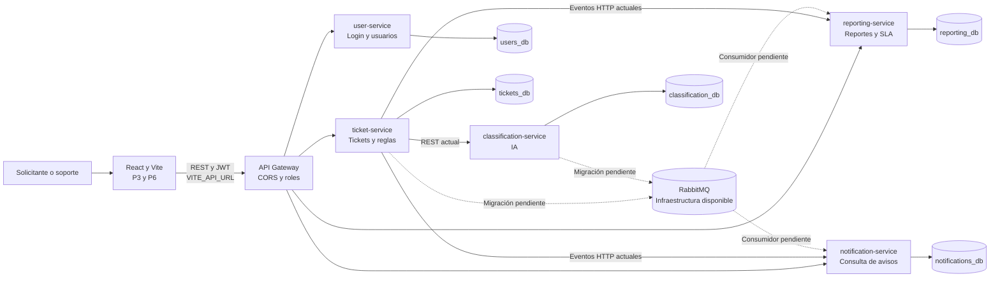

# Componentes e integración

El navegador usa exclusivamente el gateway. Los reportes se leen desde su
proyección, sin consultar bases de tickets ni conectarse a RabbitMQ.

Las líneas discontinuas son trabajo pendiente de integración de la entrega 2,
no funciones confirmadas por este frontend. El backend revisado está en
`dev/entrega-2`, commit `bbc94d7`: contiene RabbitMQ y sus dependencias de
arranque, mientras los contratos REST copiados siguen siendo los de
`31bf44a` y no cambiaron con ese pull.

RabbitMQ y sus credenciales permanecen en la red del backend. El frontend nunca
recibe RABBITMQ_URL, RABBITMQ_PASSWORD ni el secreto de firma JWT.
